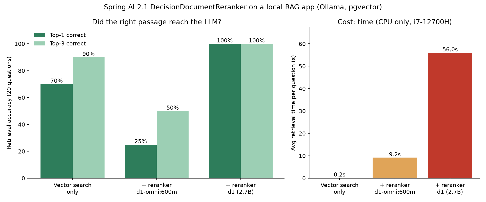

# Spring AI 2.1 DecisionDocumentReranker — measured on a local RAG app

Does Spring AI 2.1's new `DecisionDocumentReranker` actually improve RAG retrieval?
This repo is a small, fully local experiment (Spring Boot 4.2 · Spring AI 2.1.0 · pgvector · Ollama — no API key)
plus the raw results.



| Setup | Top-1 correct | Top-3 correct | Avg retrieval time |
|---|---|---|---|
| Vector search only | 14/20 (70%) | 18/20 (90%) | ~0.2 s |
| + reranker, `d1-omni:600m` (default) | 5/20 (25%) | 10/20 (50%) | 9.2 s |
| + reranker, `d1` (2.7B) | 20/20 (100%) | 20/20 (100%) | 56 s |

*20 labelled questions over a fictional courier help centre. CPU only: Intel i7-12700H, 40 GB RAM, no GPU.*

## What's here

- [`code/`](code) — the Spring Boot app: `/ask` (baseline vs reranked answer) and `/eval` (retrieval accuracy on 20 labelled questions). Run instructions in [code/README.md](code/README.md).
- [`proofs/`](proofs) — raw output of every run:
  - `eval-d1-omni-600m.json`, `eval-d1.json` — full eval results per question
  - `ask-cod-baseline.json`, `ask-cod-rerank-d1.json` — the COD-payout example (wrong answer → right answer)
  - `ask-baseline.json`, `ask-rerank.json` — the late-delivery example with `d1-omni:600m`
  - `make_chart.py` → `results-chart.png`

## Quick start

```powershell
cd code
docker compose up -d          # pgvector on port 5433
./gradlew bootRun             # needs Ollama >= 0.40.4; models are pulled on first start
Invoke-RestMethod -Method Post http://localhost:8080/eval -TimeoutSec 3600 | ConvertTo-Json -Depth 5
```

## Article

The full write-up is on Medium: [I Tested Spring AI 2.1's New Reranker Locally. The Small Model Made My RAG Worse.](https://medium.com/@swaroop1232010/i-tested-spring-ai-2-1s-new-reranker-locally-the-small-model-made-my-rag-worse-ff970ce0de65)
